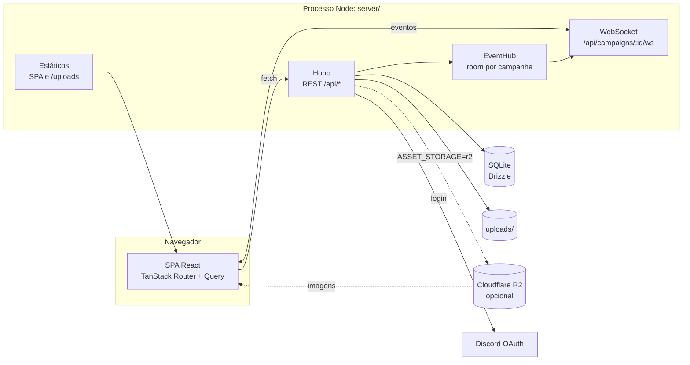
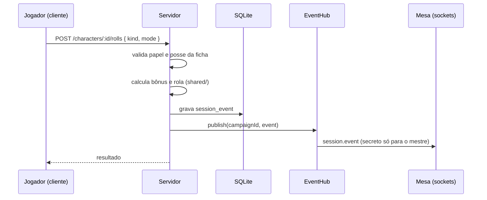

# Arquitetura

Como o quest-fast é organizado, por que é assim e onde mexer para cada tipo de
mudança. Para rodar o projeto, veja o [`README.md`](../README.md); para o
processo de contribuição, o [`CONTRIBUTING.md`](../CONTRIBUTING.md).

## Visão geral

Um único processo Node serve tudo: o SPA buildado, a API REST e o WebSocket.
Os dados ficam num arquivo SQLite e os uploads, em disco ou, se quem hospeda
escolher, num bucket do Cloudflare R2 (veja
[Armazenamento de arquivos](#armazenamento-de-arquivos)).



Escala alvo: uma mesa self-hosted, na ordem de 10 usuários e 3 conectados ao
mesmo tempo por campanha. É essa escala que justifica SQLite e um processo
único. Se o produto virar SaaS, essas escolhas precisam ser revistas.

## Workspaces

O repositório é um monorepo de npm workspaces. `npm ci` na raiz instala tudo.

| Workspace | Pacote | Papel | Depende de |
| --- | --- | --- | --- |
| `shared/` | `@quest-fast/shared` | Tipos da API e regras 5e puras | nada |
| `db/` | `@quest-fast/db` | Schema Drizzle, migrações, seed | `shared` |
| `server/` | — | Hono: REST, auth, WebSocket, estáticos | `shared`, `db` |
| `client/` | `@quest-fast/client` | SPA React | `shared` |

Não há etapa de build no backend: o Node 22.18+ executa TypeScript direto
(type stripping). Por isso o código de `shared/`, `db/` e `server/` usa só
sintaxe "apagável" (`erasableSyntaxOnly`): nada de `enum`, `namespace` ou
parameter properties. Os imports levam a extensão `.ts`.

### `shared/` — contrato e regras

- `api.ts`: tipos de request/response e de eventos (`SessionEvent`,
  `SocketMessage`). É o contrato entre cliente e servidor; mudar um tipo aqui
  faz o `typecheck` apontar os dois lados.
- `dice.ts`: parser de expressões (`2d6+3`) e rolador com
  vantagem/desvantagem.
- `modifiers.ts`, `sheet.ts`: modificadores, proficiência, perícias com
  especialização, iniciativa, percepção passiva, CD e ataque mágico, dano e
  cura.
- `combat.ts`: regras do combate — as 15 condições (com exaustão e duração),
  ordem de iniciativa, avanço e recuo de turno, faixa de saúde, CD de
  concentração, teste contra a morte, numeração de cópias e limites do
  statblock.
- `sheet-import.ts`: leitura dos campos do PDF da ficha oficial de 2024, com
  avisos do que não deu para ler com segurança. `statblock-import.ts` converte
  essa leitura numa criatura do bestiário (NPC escrito na ficha oficial).
- `validation.ts`: validação da ficha e do statblock, usada pelo formulário
  (feedback por campo) e pelo servidor (o que vale).
- `invite.ts`, `role.ts`: código de convite e papéis (`master`, `player`).

Tudo aqui é função pura, com teste unitário ao lado (`*.test.ts`, rodando no
`node:test`).

### `db/` — persistência

- `src/schema.ts`: tabelas `users`, `sessions`, `campaigns`,
  `campaign_members`, `assets`, `characters`, `session_events` e, do
  combate, `statblocks`, `encounters` e `combatants`. Partes
  extensas da ficha (perícias, ataques, magias, inventário) e o `payload` dos
  eventos são colunas JSON. Um campo novo dentro delas não ganha migração: o
  servidor lê o JSON antigo com o padrão documentado (um ataque salvo sem
  `kind` é uma rolagem de ataque).
- `migrations/`: SQL gerado pelo `drizzle-kit`, uma pasta por migração
  (`<timestamp>_<nome>/migration.sql` e `snapshot.json`). Mudou o schema: rode
  `npm run db:generate` e versione a migração gerada. Migrações já publicadas
  não são editadas.
- `src/migrate.ts`: aplica as migrações. No Docker, roda na subida do
  container.
- `src/seed.ts`: campanha de exemplo e um cookie de sessão para desenvolver
  sem passar pelo Discord.

O driver é `better-sqlite3` (síncrono). Trocar para Postgres seria troca de
driver e de migrações, não de arquitetura.

### `server/` — autoridade

```
src/
  index.ts        sobe o HTTP server e acopla o WebSocket
  app.ts          monta as rotas (createApp recebe as dependências)
  context.ts      Deps (db, env, discord, hub, assets) e variáveis do Hono
  middleware.ts   requireAuth e requireCampaignRole
  env.ts          leitura e validação das variáveis de ambiente
  auth/           OAuth do Discord e sessão em cookie
  campaigns/      campanhas, convite e membros
  characters/     ficha, estado de sessão e rolagens pela ficha
  statblocks/     bestiário da campanha (só o mestre)
  combat/         encontros, iniciativa, turnos e a projeção por papel
  dice/           rolagem livre
  feed/           leitura paginada do feed
  assets/         upload de imagens (store em disco, no R2 ou em memória)
  events/         EventHub, persistência e redação do feed, WebSocket
  validation.ts   parsers de entrada compartilhados (InputError, ataques)
  testing.ts      helpers dos testes de integração
```

Cada módulo de domínio expõe uma função `xxxRoutes()` que devolve um `Hono`
montado em `app.ts`:

| Prefixo | Módulo |
| --- | --- |
| `/api/auth` | `auth/` |
| `/api/campaigns` | `campaigns/` |
| `/api/campaigns/:campaignId/characters` | `characters/` |
| `/api/campaigns/:campaignId/assets` | `assets/` |
| `/api/campaigns/:campaignId/rolls` | `dice/` |
| `/api/campaigns/:campaignId/feed` | `feed/` |
| `/api/campaigns/:campaignId/statblocks` | `statblocks/` |
| `/api/campaigns/:campaignId/encounters` | `combat/` |
| `/api/campaigns/:campaignId/ws` | `events/ws.ts` (upgrade) |

As dependências chegam por injeção (`createApp(deps)`), não por import de
singleton. É isso que deixa os testes de integração trocarem o Discord por um
provedor falso e o disco por um store em memória.

### `client/` — interface

```
src/
  main.tsx         QueryClient + RouterProvider
  router.tsx       rotas; o guard de autenticação consulta /api/auth/me
  screens/         telas e seções que buscam dados (Login, Campaigns, Campaign...)
  components/      componentes presentacionais do design system
  hooks/           useCampaignSocket, useActiveSection
  lib/             cliente da API, cache do feed, rótulos 5e, formatação
  styles/          tokens (index.css), componentes (components.css), telas
  stories/         Storybook: catálogo e fonte de verdade da interface
```

- **Dados:** TanStack Query para todo estado vindo do servidor. O cliente da
  API (`lib/api.ts`) só transporta e traduz erros; não calcula papel nem
  visibilidade.
- **Tempo real:** `useCampaignSocket` abre o socket da campanha, reconecta com
  backoff e, ao reconectar, refaz o fetch do feed. Eventos novos entram no
  cache do Query via `lib/feed-cache.ts`.
- **Componentes:** `components/` não busca dados; recebe props e é coberto por
  story. `screens/` compõe componentes e liga com a API.
- **Estilo:** Tailwind 4 com tokens CSS próprios. Cor crua e paleta padrão do
  Tailwind são proibidas pelo lint; o porquê está em
  [`design-system.md`](design-system.md).

## Fluxos principais

### Autenticação

1. `GET /api/auth/discord` gera um `state` (contra CSRF) e redireciona ao
   Discord, pedindo só o escopo `identify`.
2. O callback troca o código, cria ou atualiza o `User` e abre uma sessão na
   tabela `sessions`.
3. O cookie `qf_session` é HttpOnly; a sessão é invalidada no servidor no
   logout.

### Autorização

- `requireAuth` resolve o usuário pelo cookie. Sem sessão: 401.
- `requireCampaignRole(...roles)` resolve o papel em `campaign_members`. Quem
  não é membro recebe **404**, não 403: confirmar que a campanha existe já
  seria um vazamento.
- Regras finas (dono da ficha edita, mestre exclui, etc.) ficam na rota, com
  teste de integração no formato "jogador não consegue X".

### Rolagem e feed ao vivo



O cliente nunca rola: envia a intenção, o servidor calcula com os valores
salvos da ficha e devolve o resultado pronto. Rolagens secretas do mestre são
filtradas tanto na leitura do feed (no SQL) quanto no broadcast do socket.

O WebSocket autoriza **antes** do upgrade (sessão e papel); um socket nunca
troca de campanha. O hub guarda o papel e o `userId` de cada conexão: eventos
do feed passam por `redactEvent` (o mesmo filtro da leitura paginada) e o
combate sai por `publishCombat`, que chama `projectEncounter` para cada
socket. Como o papel é conferido só no upgrade, toda rota que encerra uma
filiação (o mestre remove o membro ou ele sai) chama `hub.kick`, que tira os
sockets daquele usuário da sala e os fecha com o código 4404; uma rota futura
que mude o papel precisa fazer o mesmo, para a reconexão passar pela
autorização de novo. Não há replay de eventos: ao reconectar, o cliente refaz o
fetch. Novos tipos de evento (combate, tokens) entram no mesmo canal, e o
cliente tem fallback para tipos que ainda não sabe renderizar.

### Combate

Toda mudança num encontro segue o mesmo caminho, numa transação SQLite: lê o
encontro e os combatentes, aplica as regras de `shared/src/combat.ts`,
incrementa `version` e grava; depois publica `combat.updated` com o estado
completo **projetado para cada conexão** e responde com a projeção de quem
pediu. O jogador nunca recebe encontro em preparação, combatente escondido nem
PV, CA ou iniciativa de monstro — vê só a faixa de saúde. Pelo mesmo motivo,
toda rolagem de iniciativa feita na preparação vai para o feed como secreta. O
cliente descarta mensagem com `version` menor que a conhecida e refaz o fetch
ao reconectar.

Pedido de turno leva `expectedActiveCombatantId` e `expectedRound`: se não
baterem com o turno atual, a resposta é 409 com o estado atual, o que evita
turno pulado duas vezes por clique duplo ou mestre e jogador ao mesmo tempo. O
round é o que distingue dois turnos seguidos do mesmo combatente quando só ele
está de pé. PV e condições de personagem continuam na ficha; mudar a ficha de
quem está num encontro também publica `combat.updated`, e excluí-la passa o
turno adiante, como remover o combatente, antes de o cascade apagá-lo.

## Armazenamento de arquivos

Avatares (e, no VTT, mapas) passam pelo `AssetStore` em
`server/src/assets/store.ts`. As rotas só conhecem essa interface:
`save` guarda o arquivo e `urlFor` diz de onde o navegador o carrega. O
armazenamento é escolhido uma vez, na subida, por `ASSET_STORAGE`.

| Modo | Onde fica | Como o navegador carrega |
| --- | --- | --- |
| `disk` (padrão) | `UPLOADS_DIR`, ao lado do banco | `/uploads/...`, servido pelo próprio processo |
| `r2` | Bucket do Cloudflare R2 | `R2_PUBLIC_URL/...`, direto da rede da Cloudflare |

O banco guarda só o caminho (`campaigns/<campanha>/<uuid>.<ext>`), nunca a
URL. O mesmo caminho é o arquivo no disco e a chave no bucket, então a URL é
montada na leitura e trocar de armazenamento é copiar a pasta para o bucket,
sem migração de dados. Cada caminho leva um UUID novo e nunca é sobrescrito,
por isso o R2 entrega as imagens com cache permanente
(`Cache-Control: immutable`).

### Por que R2, e por que opcional

**Por que um armazenamento de objetos.** Em disco, cada imagem passa pelo
processo Node, e o arquivo se perde se o volume não for persistido. Num
bucket, as imagens sobrevivem a qualquer recriação do servidor e são entregues
por uma CDN, perto de quem está na mesa.

**Por que Cloudflare R2, e não Amazon S3.** Avatar é escrito uma vez e lido a
cada abertura de campanha, por todos os jogadores. O custo que cresce é o de
leitura, e o R2 não cobra transferência de saída. O S3 cobra cada GB baixado
além da cota gratuita e só vira CDN com o CloudFront na frente, que é um
segundo serviço para configurar. O R2 ainda tem um plano gratuito permanente
que cobre com folga os avatares de uma mesa. A API do R2 é a do S3, e o
servidor usa o SDK oficial da AWS (`@aws-sdk/client-s3`): voltar para o S3,
ou ir para qualquer serviço compatível, é configuração, não código novo.

**Por que opcional.** O princípio 3 (um processo, um artefato) e a escala
alvo continuam valendo: quem hospeda uma mesa sozinho não precisa de conta em
serviço externo, e o disco segue como padrão. O R2 é uma escolha de quem
hospeda, para não depender do volume local e tirar o tráfego de imagens do
servidor. Nada no cliente muda: ele recebe uma URL pronta, como antes.

**Alternativas descartadas.**

- **Amazon S3 com CloudFront:** mesmo resultado, mas com taxa de saída e dois
  serviços para configurar.
- **R2 obrigatório:** quebraria o self-host sem conta na Cloudflare.
- **Guardar a URL completa no banco:** trocar de armazenamento, ou de domínio
  do bucket, exigiria migrar todas as linhas de `assets`.

**Consequências.**

- Ligar o R2 numa instância com avatares em disco exige copiar `UPLOADS_DIR`
  para o bucket. Até lá, os avatares antigos não aparecem. O passo a passo está
  no [`README.md`](../README.md#avatares-no-cloudflare-r2-opcional).
- `/uploads` continua servido mesmo com o R2 ligado, então voltar para `disk`
  não perde o que ainda está no disco.
- Uma falha ao guardar no bucket responde 502 com mensagem em português, e
  nenhuma linha é gravada em `assets` para um arquivo que não foi guardado.
- As credenciais do R2 ficam só no servidor, em variáveis de ambiente. O
  navegador nunca escreve no bucket: o upload continua passando pela rota, que
  valida tipo, tamanho e papel na campanha.

## Princípios

São as regras que não mudam de uma feature para outra:

1. **O servidor é a fonte de verdade.** Rolagens, permissões, visibilidade e
   estado de jogo são calculados e autorizados no servidor.
2. **Regra 5e pura vive em `shared/`**, com teste unitário. Cliente usa para
   preview e validação; servidor usa para valer.
3. **Um processo, um artefato.** Nada de serviço extra sem uma razão que a
   escala alvo justifique.
4. **Fatias verticais.** Cada entrega precisa ser usável numa sessão real.
5. **Idioma:** código em inglês (identificadores, arquivos, rotas, campos
   JSON, colunas, comentários, descrições de teste); texto visível ao usuário e
   documentação em pt-BR. Mensagens de erro da API são texto visível: campo
   `error`, conteúdo em português.

## Decisões registradas

O raciocínio completo, com alternativas descartadas, está em
[`history/`](history/). Resumo:

| Decisão | Por quê | Onde |
| --- | --- | --- |
| Vite + React SPA + Hono, não Next.js | Tudo atrás de login (sem SEO/SSR) e o WebSocket precisa morar no mesmo processo | [MVP, decisão 1](history/2026-09-04-mvp-campaign-management.md) |
| SQLite + Drizzle, não Postgres | Uma mesa por instância; backup é copiar um arquivo | [MVP, decisão 5](history/2026-09-04-mvp-campaign-management.md) |
| `better-sqlite3`, não `node:sqlite` | `node:sqlite` ainda é experimental | [MVP, decisão 5](history/2026-09-04-mvp-campaign-management.md) |
| Discord OAuth como único login | O público já tem Discord; menos código que senha | [MVP, decisão 6](history/2026-09-04-mvp-campaign-management.md) |
| WebSocket, não SSE | O arrasto de tokens do VTT vai exigir latência baixa nos dois sentidos | [MVP, decisão 8](history/2026-09-04-mvp-campaign-management.md) |
| Personagem nasce dentro da campanha | Elimina vínculo e desvínculo e a questão do histórico | [MVP, decisão 9](history/2026-09-04-mvp-campaign-management.md) |
| Tabela `Asset` desde o MVP | Avatares hoje, mapas grandes no VTT | [MVP, decisão 11](history/2026-09-04-mvp-campaign-management.md) |
| `SessionEvent` como união discriminada, com fallback | Combate e VTT adicionam tipos sem quebrar o cliente | [session-qol](history/2026-09-10-session-qol-foundations.md) |
| Ficha oficial 2024, sem motor de regras | Valores derivados com ajuste manual; sem calcular CA por armadura | [ficha oficial](history/2026-09-13-official-character-sheet.md) |
| PV, condições e concentração do personagem só na ficha | O combatente que vem de um personagem lê e grava a ficha; nunca há dois PV divergentes | [combate](history/2026-10-22-combat-and-bestiary.md) |
| Combate projetado por papel no servidor | O jogador nunca recebe PV de monstro, combatente escondido nem encontro em preparação, nem no REST nem no socket | [combate](history/2026-10-22-combat-and-bestiary.md) |
| Combatente com id estável, turno por identidade | O token do VTT vai se ancorar no combatente; adicionar ou remover alguém não move o turno | [combate](history/2026-10-22-combat-and-bestiary.md) |
| Tokens próprios + Storybook como fonte da interface | Consistência e auditoria automática de a11y/overflow | [design system](history/2026-09-04-design-system-foundation.md) |
| Uploads em disco por padrão, Cloudflare R2 opcional (não S3) | Avatar é muito lido: o R2 não cobra saída e já é CDN; o disco mantém o self-host sem conta externa | [Armazenamento de arquivos](#armazenamento-de-arquivos) |

Decisão nova que mude um desses pontos, ou um dos princípios acima, deve ser
registrada: atualize este documento no mesmo PR e explique o porquê na
descrição do PR.

## Onde mexer

| Quero... | Arquivos |
| --- | --- |
| Mudar uma regra 5e | `shared/src/sheet.ts` ou `modifiers.ts` + teste em `shared/` |
| Adicionar campo à ficha | `shared/src/api.ts` → `db/src/schema.ts` + `npm run db:generate` → `server/src/characters/` → `client/` (story antes da tela) |
| Criar uma rota | módulo em `server/src/<domínio>/routes.ts`, montado em `app.ts`, com teste de RBAC |
| Emitir um novo tipo de evento | tipo em `shared/src/api.ts`, gravação em `server/src/events/`, renderização em `FeedEventCard` |
| Criar um componente | story em `client/src/stories/`, componente em `client/src/components/`, `npm run test:design` |
| Ajustar cor, tipografia ou espaçamento | tokens em `client/src/styles/index.css` e [`design-system.md`](design-system.md) |
| Mudar onde os uploads ficam | `server/src/assets/store.ts` (um `AssetStore` novo), `server/src/env.ts` e a escolha em `server/src/index.ts` |

## Testes

| Camada | Ferramenta | Onde |
| --- | --- | --- |
| Regras puras | `node:test` | `shared/src/*.test.ts` |
| API, RBAC e WebSocket | `node:test` com app e SQLite em memória; o WebSocket sobe um servidor real em porta efêmera | `server/src/**/*.test.ts` |
| Design system | Storybook + Playwright + axe | `npm run test:design` |
| Fluxo real | Playwright contra o app rodando | `npm run verify:app`, `verify:group` |
| Qualidade React | React Doctor, saúde 100 obrigatória no CI | `npm run doctor` |
