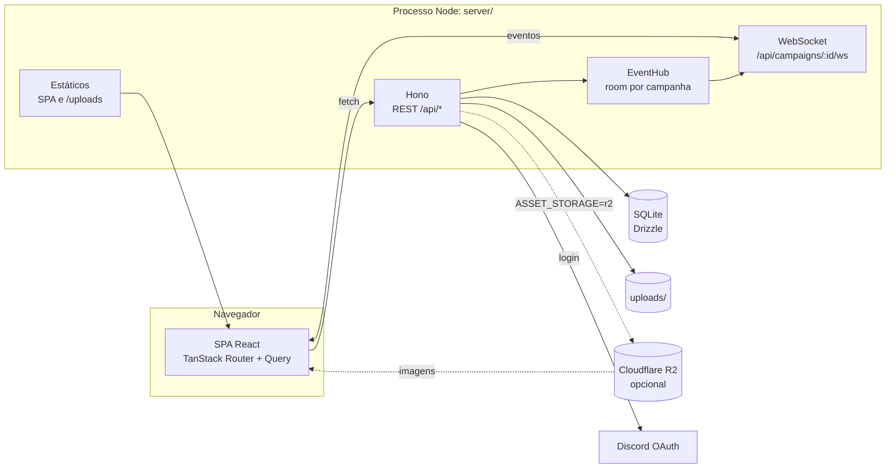
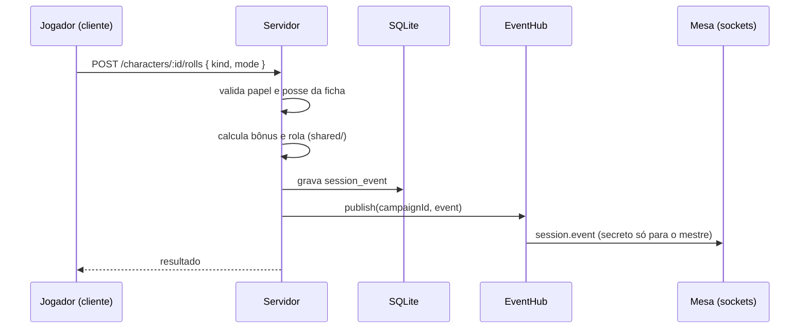
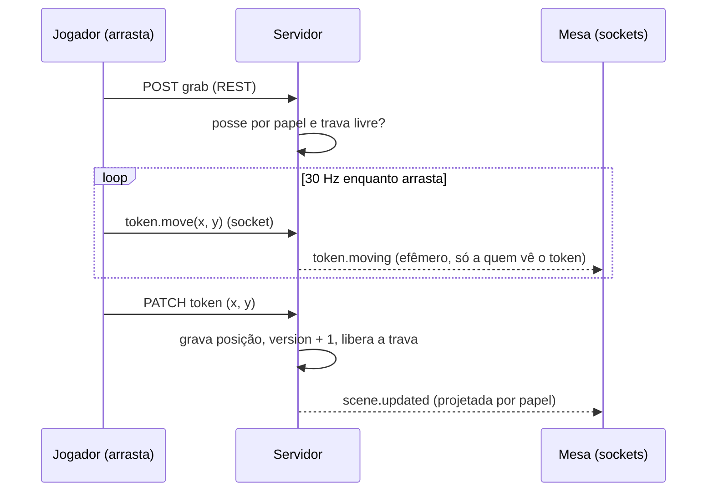

# Arquitetura

Como o quest-fast é organizado, por que é assim e onde mexer para cada tipo de
mudança. Para rodar o projeto, veja o [`README.md`](../README.md); para o
processo de contribuição, o [`CONTRIBUTING.md`](../CONTRIBUTING.md).

## Visão geral

Um único processo Node serve tudo: o SPA buildado, a API REST e o WebSocket.
Os dados ficam num arquivo SQLite e os uploads, em disco ou, se quem hospeda
escolher, num bucket do Cloudflare R2 (veja
[Armazenamento de arquivos](#armazenamento-de-arquivos)).



Escala alvo: uma mesa self-hosted, na ordem de 10 usuários e 3 conectados ao
mesmo tempo por campanha. É essa escala que justifica SQLite e um processo
único. Se o produto virar SaaS, essas escolhas precisam ser revistas.

## Workspaces

O repositório é um monorepo de npm workspaces. `npm ci` na raiz instala tudo.

| Workspace | Pacote | Papel | Depende de |
| --- | --- | --- | --- |
| `shared/` | `@quest-fast/shared` | Tipos da API e regras 5e puras | nada |
| `db/` | `@quest-fast/db` | Schema Drizzle, migrações, seed | `shared` |
| `server/` | — | Hono: REST, auth, WebSocket, estáticos, HTML do convite e cartão PNG | `shared`, `db` |
| `client/` | `@quest-fast/client` | SPA React | `shared` |

Não há etapa de build no backend: o Node 22.18+ executa TypeScript direto
(type stripping). Por isso o código de `shared/`, `db/` e `server/` usa só
sintaxe "apagável" (`erasableSyntaxOnly`): nada de `enum`, `namespace` ou
parameter properties. Os imports levam a extensão `.ts`.

### `shared/` — contrato e regras

- `api.ts`: tipos de request/response e de eventos (`SessionEvent`,
  `SocketMessage`). É o contrato entre cliente e servidor; mudar um tipo aqui
  faz o `typecheck` apontar os dois lados.
- `dice.ts`: parser de expressões (`2d6+3`) e rolador com
  vantagem/desvantagem.
- `modifiers.ts`, `sheet.ts`: modificadores, proficiência, perícias com
  especialização, iniciativa, percepção passiva, CD e ataque mágico, dano e
  cura.
- `combat.ts`: regras do combate — as 15 condições (com exaustão e duração),
  ordem de iniciativa, avanço e recuo de turno, faixa de saúde, CD de
  concentração, teste contra a morte, numeração de cópias e limites do
  statblock.
- `sheet-import.ts`: leitura dos campos do PDF da ficha oficial de 2024, com
  avisos do que não deu para ler com segurança. `statblock-import.ts` converte
  essa leitura numa criatura do bestiário (NPC escrito na ficha oficial).
- `validation.ts`: validação da ficha e do statblock, usada pelo formulário
  (feedback por campo) e pelo servidor (o que vale).
- `invite.ts`, `role.ts`: código de convite e papéis (`master`, `player`).
- `invite-link.ts`: caminho e textos do convite (`invitePath`,
  `invitePreviewText`), link do WhatsApp, destino de retorno do login
  (`safeReturnPath`, `loginFailurePath`).
- `initials.ts`: as iniciais usadas no avatar, no cartão do convite e na
  interface.

Tudo aqui é função pura, com teste unitário ao lado (`*.test.ts`, rodando no
`node:test`).

### `db/` — persistência

- `src/schema.ts`: tabelas `users`, `sessions`, `campaigns`,
  `campaign_members`, `campaign_bans`, `assets`, `characters`, `session_events` e, do
  combate, `statblocks`, `encounters` e `combatants`. Partes
  extensas da ficha (perícias, ataques, magias, inventário) e o `payload` dos
  eventos são colunas JSON. Um campo novo dentro delas não ganha migração: o
  servidor lê o JSON antigo com o padrão documentado (um ataque salvo sem
  `kind` é uma rolagem de ataque).
- **Personagem ativo:** `characters.active` marca o personagem que o jogador
  leva à mesa de uma campanha. O índice único parcial
  `characters_one_active_idx` (`campaign_id`, `owner_id` onde `active = 1`)
  garante no máximo um ativo por jogador e campanha, mesmo com requisições
  simultâneas.
- `migrations/`: SQL gerado pelo `drizzle-kit`, uma pasta por migração
  (`<timestamp>_<nome>/migration.sql` e `snapshot.json`). Mudou o schema: rode
  `npm run db:generate` e versione a migração gerada. Migrações já publicadas
  não são editadas.
- `src/migrate.ts`: aplica as migrações. No Docker, roda na subida do
  container.
- `src/seed.ts`: campanha de exemplo e um cookie de sessão para desenvolver
  sem passar pelo Discord.

O driver é `better-sqlite3` (síncrono). Trocar para Postgres seria troca de
driver e de migrações, não de arquitetura.

### `server/` — autoridade

```
src/
  index.ts        sobe o HTTP server e acopla o WebSocket
  app.ts          monta as rotas (createApp recebe as dependências)
  context.ts      Deps (db, env, discord, hub, assets) e variáveis do Hono
  middleware.ts   requireAuth, optionalAuth e requireCampaignRole
  env.ts          leitura e validação das variáveis de ambiente
  auth/           OAuth do Discord e sessão em cookie
  campaigns/      campanhas, convite, membros e bloqueados
  invites/        prévia pública do convite, HTML com metas e cartão PNG
  characters/     ficha, estado de sessão e rolagens pela ficha
  statblocks/     bestiário da campanha (só o mestre)
  combat/         encontros, iniciativa, turnos e a projeção por papel
  scenes/         cenas do VTT: mapa, grid, cena aberta e a projeção por papel
  dice/           rolagem livre
  feed/           leitura paginada do feed
  assets/         upload e normalização de imagens (store em disco, no R2 ou em memória)
  events/         EventHub, persistência e redação do feed, WebSocket
  validation.ts   parsers de entrada compartilhados (InputError, ataques)
  testing.ts      helpers dos testes de integração
```

Cada módulo de domínio expõe uma função `xxxRoutes()` que devolve um `Hono`
montado em `app.ts`:

| Prefixo | Módulo |
| --- | --- |
| `/api/auth` | `auth/` |
| `/api/campaigns` | `campaigns/` |
| `/api/invites` | `invites/` (público) |
| `/invite/:code` | `invites/` (HTML do SPA com metas) |
| `/api/campaigns/:campaignId/characters` | `characters/` |
| `/api/campaigns/:campaignId/assets` | `assets/` |
| `/api/campaigns/:campaignId/rolls` | `dice/` |
| `/api/campaigns/:campaignId/feed` | `feed/` |
| `/api/campaigns/:campaignId/statblocks` | `statblocks/` |
| `/api/campaigns/:campaignId/encounters` | `combat/` |
| `/api/campaigns/:campaignId/scenes` | `scenes/` |
| `/api/campaigns/:campaignId/ws` | `events/ws.ts` (upgrade) |

As dependências chegam por injeção (`createApp(deps)`), não por import de
singleton. É isso que deixa os testes de integração trocarem o Discord por um
provedor falso e o disco por um store em memória.

### `client/` — interface

```
src/
  main.tsx         QueryClient + RouterProvider
  router.tsx       rotas; o guard de autenticação consulta /api/auth/me
  screens/         telas que buscam dados (Login, Campaigns, MyCharacters, CampaignWorkspace e campaign/)
  components/      componentes presentacionais do design system
  hooks/           useCampaignSocket, useStoredFlag, useSignOut
  lib/             cliente da API, cache do feed, rótulos 5e, formatação
  styles/          tokens (index.css) e relevo dos primitivos (ui.css)
  stories/         Storybook: catálogo e fonte de verdade da interface
```

- **Dados:** TanStack Query para todo estado vindo do servidor. O cliente da
  API (`lib/api.ts`) só transporta e traduz erros; não calcula papel nem
  visibilidade.
- **Telas da campanha:** `/campaigns/$campaignId` é uma rota de layout
  (`CampaignWorkspace`: menu lateral e socket) com uma rota filha por tela:
  Visão geral (`/`), Mesa (`/table`: fichas, combate em andamento, dados e
  feed), Preparo (`/prep`: encontros e bestiário, só do mestre) e Jogadores
  (`/players`: membros, convite, bloqueados). O item ativo do menu vem da rota
  (`aria-current="page"`). Jogador em `/prep` vê "não encontrado", como o
  servidor responde ao que não é dele. Rotas em inglês, texto em pt-BR.
  Plano e próximas etapas na issue #88.
- **Telas da conta:** Campanhas (`/campaigns`) e Meus personagens
  (`/characters`). O personagem é do jogador: criar (escolhendo a campanha),
  editar, trocar o retrato, importar o PDF, excluir e ativar acontecem na
  galeria da conta. A ficha abre no modal de sempre com `canRoll={false}`;
  rolar e gastar o turno acontecem na Mesa, que mostra só o personagem ativo de
  cada jogador e não oferece edição. A Visão geral mostra o grupo (os ativos)
  em medalhões, também só para ler.
- **Tempo real:** `useCampaignSocket` abre o socket da campanha no layout, uma
  vez por campanha, para o selo de rodada e os caches seguirem vivos em
  qualquer tela; o status chega às telas pelo contexto
  `CampaignSocketStatus`. Reconecta com backoff e, ao reconectar, refaz o
  fetch do feed. Eventos novos entram no cache do Query via
  `lib/feed-cache.ts`.
- **Componentes:** `components/` não busca dados; recebe props e é coberto por
  story. `screens/` compõe componentes e liga com a API.
- **Estilo:** Tailwind 4 com tokens CSS próprios. Cor crua e paleta padrão do
  Tailwind são proibidas pelo lint; o porquê está em
  [`design-system.md`](design-system.md).

## Fluxos principais

### Autenticação

1. `GET /api/auth/discord` gera um `state` (contra CSRF) e redireciona ao
   Discord, pedindo só o escopo `identify`.
2. O callback troca o código, cria ou atualiza o `User` e abre uma sessão na
   tabela `sessions`.
3. O cookie `qf_session` é HttpOnly; a sessão é invalidada no servidor no
   logout.

### Convite por link

O link do convite é o código de convite que já existia: `/invite/<código>`.
Trocar o código (`POST /api/campaigns/:id/invite`) invalida o link e o código
digitado de uma vez.

- `GET /api/invites/:code` é público (`optionalAuth`) e expõe só o nome da
  campanha, o nome e o avatar do mestre e o número de jogadores. Quem está
  logado recebe também a própria situação (já é membro, bloqueado, etc.).
- `GET /invite/:code` devolve o `index.html` do SPA com as metas Open Graph e
  Twitter injetadas no servidor (`invites/meta.ts`), porque o rastreador do
  WhatsApp e do Discord não executa JavaScript. Os links absolutos usam
  `APP_URL`; sem ela, a origem de `DISCORD_REDIRECT_URI`.
- `GET /api/invites/:code/card.png` gera o cartão da prévia com Satori e
  `@resvg/resvg-js`, com as fontes versionadas em `server/assets/fonts`. O
  resultado fica em cache em memória e renderizações simultâneas do mesmo
  cartão são unificadas. O avatar do mestre só é baixado de
  `cdn.discordapp.com`, com timeout de 2 s e limite de 1 MB; se falhar, o
  cartão usa as iniciais.
- As três rotas acima e o `POST /api/campaigns/join` dividem um limite de
  tentativas (`invites/attempt-limiter.ts`): 20 códigos inexistentes em 10
  minutos por endereço e, no `join`, também por usuário. Estourado o limite, a
  origem recebe 429 com `Retry-After` mesmo para um código válido, e a busca
  nem é feita. A janela deslizante fica em memória, por processo. O endereço é
  o do socket; `X-Forwarded-For` só vale com `TRUST_PROXY=true`, que supõe o
  app alcançável só pelo proxy. Endereços IPv6 dividem o limite por prefixo
  `/64`, porque um único cliente costuma dispor do prefixo inteiro.
- O login guarda o destino em `?next=` no cookie `qf_oauth_next`, validado na
  ida e na volta (`safeReturnPath`); em caso de falha, volta à página do
  convite.
- Remover um membro o grava em `campaign_bans`: entrar de novo devolve 403 até
  o mestre liberar (`GET /api/campaigns/:id/bans` e
  `DELETE /api/campaigns/:id/bans/:userId`).

### Autorização

- `requireAuth` resolve o usuário pelo cookie. Sem sessão: 401.
- `requireCampaignRole(...roles)` resolve o papel em `campaign_members`. Quem
  não é membro recebe **404**, não 403: confirmar que a campanha existe já
  seria um vazamento.
- Regras finas (dono da ficha edita, mestre exclui, etc.) ficam na rota, com
  teste de integração no formato "jogador não consegue X".
- `GET /api/me/characters` filtra pelo usuário da sessão e só lista fichas das
  campanhas de que ele ainda é membro: ler uma ficha exige filiação, mesmo
  para o dono, então quem sai de uma campanha deixa de ver as fichas dela.
  Ativar (`POST .../characters/:id/activate`) é só do dono; nem o mestre ativa
  o personagem de outro.

### Rolagem e feed ao vivo



O cliente nunca rola: envia a intenção, o servidor calcula com os valores
salvos da ficha e devolve o resultado pronto. Rolagens secretas do mestre são
filtradas tanto na leitura do feed (no SQL) quanto no broadcast do socket.

O WebSocket autoriza **antes** do upgrade (sessão e papel); um socket nunca
troca de campanha. O hub guarda o papel e o `userId` de cada conexão: eventos
do feed passam por `redactEvent` (o mesmo filtro da leitura paginada) e o
combate sai por `publishCombat`, que chama `projectEncounter` para cada
socket; a cena do VTT, por `publishScene` com `projectScene`, e
`publishSceneClosed` avisa a sala inteira que a cena aberta saiu da mesa. Como o papel é conferido só no upgrade, toda rota que encerra uma
filiação (o mestre remove o membro ou ele sai) chama `hub.kick`, que tira os
sockets daquele usuário da sala e os fecha com o código 4404; uma rota futura
que mude o papel precisa fazer o mesmo, para a reconexão passar pela
autorização de novo. Não há replay de eventos: ao reconectar, o cliente refaz o
fetch. Novos tipos de evento (combate, tokens) entram no mesmo canal, e o
cliente tem fallback para tipos que ainda não sabe renderizar.

### Combate

Toda mudança num encontro segue o mesmo caminho, numa transação SQLite: lê o
encontro e os combatentes, aplica as regras de `shared/src/combat.ts`,
incrementa `version` e grava; depois publica `combat.updated` com o estado
completo **projetado para cada conexão** e responde com a projeção de quem
pediu. O jogador nunca recebe encontro em preparação, combatente escondido nem
PV, CA ou iniciativa de monstro — vê só a faixa de saúde. Pelo mesmo motivo,
toda rolagem de iniciativa feita na preparação vai para o feed como secreta. O
cliente descarta mensagem com `version` menor que a conhecida e refaz o fetch
ao reconectar. Excluir um encontro publica `combat.deleted` só para quem podia
vê-lo (o de preparação, só para o mestre); o cliente o tira do cache e, se
estava aberto, volta para o padrão da seção.

Um ataque compara o acerto com a CA do alvo no servidor e nunca aplica dano
sozinho: um acerto vira um lembrete de dano pendente no alvo, que só o mestre
aplica ou descarta, pelo mesmo caminho de qualquer dano. A redação do feed
segue a regra da projeção: do ataque de um monstro o jogador recebe acerto ou
erro, crítico e o total do dano, sem o d20, o total do acerto, a expressão, os
dados nem a CA de um alvo monstro. Com qualquer um deles, o bônus ou o dano do
statblock sairiam numa conta. O dano pendente de um ataque secreto também não
aparece para o jogador, nem no próprio personagem.

Pedido de turno leva `expectedActiveCombatantId` e `expectedRound`: se não
baterem com o turno atual, a resposta é 409 com o estado atual, o que evita
turno pulado duas vezes por clique duplo ou mestre e jogador ao mesmo tempo. O
round é o que distingue dois turnos seguidos do mesmo combatente quando só ele
está de pé. PV e condições de personagem continuam na ficha; mudar a ficha de
quem está num encontro também publica `combat.updated`, e excluí-la passa o
turno adiante, como remover o combatente, antes de o cascade apagá-lo.

### Campo de batalha (VTT) — decidido, em implementação

As escolhas da fase 4 foram fechadas por medição no
[spike do VTT](history/2026-11-12-vtt-spike.md) e detalhadas na
[spec da fase 4](history/2026-11-12-vtt-battlefield-phase4.md). Já
implementados: regras do grid e limites do mapa em `shared/src/battlefield.ts`,
a tabela `scenes` e as rotas de cena em `server/src/scenes/` (criar com o
mapa, editar nome e grid, trocar o mapa, excluir, abrir e fechar para a mesa),
com `scene.updated` e `scene.closed` no socket. As telas chegam nas próximas
seções da entrega 1; tokens e fog, nas entregas seguintes.

- **Onde as telas moram (#88).** Com a campanha dividida em rotas, a "seção
  Mapa" da spec não volta à página única: a lista de cenas do mestre é uma aba
  do Preparo (`/prep`), a miniatura da cena aberta para o jogador entra na
  Visão geral, e a "tela do mapa" é a Mesa (`/campaigns/$campaignId/table`),
  com o canvas no centro.

- **Canvas 2D direto**, sem biblioteca: pan, zoom, pinça e hit-test escritos à
  mão. A lista de tokens e o movimento por teclado ficam em DOM, fora do canvas.
- **Cena projetada por papel, como o combate.** `projectScene` monta o que
  cada um recebe, tanto na resposta REST quanto no socket. O jogador só
  enxerga a cena aberta para a mesa (`campaigns.active_scene_id`; outra cena é
  404). Toda mudança gravada sobe a `version` e publica `scene.updated` com a
  cena projetada; fechar o mapa ou excluir a cena aberta publica
  `scene.closed`.
- **Fog of war como multipolígono das áreas reveladas.** União e diferença
  (`polygon-clipping`) são regra pura em `shared/`. O mestre envia a forma e o
  modo, o servidor calcula o estado oficial e o guarda numa coluna JSON da
  `Scene`; o fog viaja dentro de `scene.updated`, o mesmo estado que recebe
  quem reconecta. O fog também decide visibilidade: token que não é de
  personagem com o centro na área oculta não sai do servidor para o jogador,
  assim como o token escondido pelo mestre e o do combatente escondido no
  encontro. Tokens de personagem aparecem sempre.
- **Movimento:** o `grab` é REST e trava o token (validade de 3 s, renovada a
  cada movimento, liberada ao soltar ou quando o socket fecha). Só quem tem a
  trava manda `token.move` pelo socket (30 Hz, sem banco), que o servidor
  repassa como `token.moving` a quem vê o token. Soltar é um `PATCH` com a
  posição: grava uma vez por arrasto, libera a trava, sobe a `version` e
  publica `scene.updated`, que vence qualquer interpolação. O receptor
  interpola com um buffer de intervalo + jitter. A posse por papel é conferida
  no `grab` e de novo ao soltar.



## Armazenamento de arquivos

Avatares (e, no VTT, mapas) passam pelo `AssetStore` em
`server/src/assets/store.ts`. As rotas só conhecem essa interface:
`save` guarda o arquivo e `urlFor` diz de onde o navegador o carrega. O
armazenamento é escolhido uma vez, na subida, por `ASSET_STORAGE`.

| Modo | Onde fica | Como o navegador carrega |
| --- | --- | --- |
| `disk` (padrão) | `UPLOADS_DIR`, ao lado do banco | `/uploads/...`, servido pelo próprio processo |
| `r2` | Bucket do Cloudflare R2 | `R2_PUBLIC_URL/...`, direto da rede da Cloudflare |

O banco guarda só o caminho (`campaigns/<campanha>/<uuid>.<ext>`), nunca a
URL. O mesmo caminho é o arquivo no disco e a chave no bucket, então a URL é
montada na leitura e trocar de armazenamento é copiar a pasta para o bucket,
sem migração de dados. Cada caminho leva um UUID novo e nunca é sobrescrito,
por isso o R2 entrega as imagens com cache permanente
(`Cache-Control: immutable`).

O servidor não confia no tipo nem no nome que o navegador manda: abre a imagem
com `sharp` e guarda a própria cópia (`server/src/assets/image.ts`). O
`sharp` roda fora da thread principal e é dependência nativa no mesmo
processo, como o `better-sqlite3`; no Windows, instala com `--ignore-scripts`.

- **Avatares:** entrada de até 5 MB (413 acima disso) e até 8192 px em cada
  lado, lidos só do cabeçalho antes de decodificar (`limitInputPixels` como
  segunda barreira contra imagem-bomba). Uma imagem no limite chega a ~400 MB
  durante a decodificação, então os uploads são processados um de cada vez:
  pedidos em paralelo esperam na fila em vez de somar memória no processo
  único. Aceita PNG, JPEG, WebP e GIF pelo formato
  detectado no conteúdo; o resto, ou o que não decodifica, recebe 422 sem
  tocar no armazenamento nem gravar linha em `assets`. A saída é WebP q82 com
  até 512 px de lado (sem ampliar), orientação EXIF aplicada aos pixels e
  transparência mantida. Nenhum metadado (EXIF, GPS, ICC, XMP) sobrevive, e
  do GIF animado fica só o primeiro quadro. O banco guarda o tipo e o tamanho
  da cópia, não do arquivo enviado. Avatares enviados antes disso não foram
  reprocessados.
- **Mapas do VTT** (`server/src/assets/maps.ts`, decidido no
  [spike](history/2026-11-12-vtt-spike.md)): entrada JPEG, PNG ou WebP de 64 a
  8192 px de lado e até 25 MB (o corpo maior que isso é recusado com 413 antes
  de ser lido); saída em JPEG mozjpeg q82 com até 4096 px de lado, sem
  metadados, orientação EXIF aplicada e transparência sobre branco. A largura e
  a altura da cópia são o espaço do grid, dos tokens e do fog. Mapas e avatares
  dividem a mesma fila de decodificação. Ao trocar o mapa ou excluir a cena, a
  linha em `assets` sai, mas o arquivo fica no armazenamento, como o avatar
  substituído.

### Por que R2, e por que opcional

**Por que um armazenamento de objetos.** Em disco, cada imagem passa pelo
processo Node, e o arquivo se perde se o volume não for persistido. Num
bucket, as imagens sobrevivem a qualquer recriação do servidor e são entregues
por uma CDN, perto de quem está na mesa.

**Por que Cloudflare R2, e não Amazon S3.** Avatar é escrito uma vez e lido a
cada abertura de campanha, por todos os jogadores. O custo que cresce é o de
leitura, e o R2 não cobra transferência de saída. O S3 cobra cada GB baixado
além da cota gratuita e só vira CDN com o CloudFront na frente, que é um
segundo serviço para configurar. O R2 ainda tem um plano gratuito permanente
que cobre com folga os avatares de uma mesa. A API do R2 é a do S3, e o
servidor usa o SDK oficial da AWS (`@aws-sdk/client-s3`): voltar para o S3,
ou ir para qualquer serviço compatível, é configuração, não código novo.

**Por que opcional.** O princípio 3 (um processo, um artefato) e a escala
alvo continuam valendo: quem hospeda uma mesa sozinho não precisa de conta em
serviço externo, e o disco segue como padrão. O R2 é uma escolha de quem
hospeda, para não depender do volume local e tirar o tráfego de imagens do
servidor. Nada no cliente muda: ele recebe uma URL pronta, como antes.

**Alternativas descartadas.**

- **Amazon S3 com CloudFront:** mesmo resultado, mas com taxa de saída e dois
  serviços para configurar.
- **R2 obrigatório:** quebraria o self-host sem conta na Cloudflare.
- **Guardar a URL completa no banco:** trocar de armazenamento, ou de domínio
  do bucket, exigiria migrar todas as linhas de `assets`.

**Consequências.**

- Ligar o R2 numa instância com avatares em disco exige copiar `UPLOADS_DIR`
  para o bucket. Até lá, os avatares antigos não aparecem. O passo a passo está
  no [`README.md`](../README.md#avatares-no-cloudflare-r2-opcional).
- `/uploads` continua servido mesmo com o R2 ligado, então voltar para `disk`
  não perde o que ainda está no disco.
- Uma falha ao guardar no bucket responde 502 com mensagem em português, e
  nenhuma linha é gravada em `assets` para um arquivo que não foi guardado.
- As credenciais do R2 ficam só no servidor, em variáveis de ambiente. O
  navegador nunca escreve no bucket: o upload continua passando pela rota, que
  valida tipo, tamanho e papel na campanha.

## Princípios

São as regras que não mudam de uma feature para outra:

1. **O servidor é a fonte de verdade.** Rolagens, permissões, visibilidade e
   estado de jogo são calculados e autorizados no servidor.
2. **Regra 5e pura vive em `shared/`**, com teste unitário. Cliente usa para
   preview e validação; servidor usa para valer.
3. **Um processo, um artefato.** Nada de serviço extra sem uma razão que a
   escala alvo justifique.
4. **Fatias verticais.** Cada entrega precisa ser usável numa sessão real.
5. **Idioma:** código em inglês (identificadores, arquivos, rotas, campos
   JSON, colunas, comentários, descrições de teste); texto visível ao usuário e
   documentação em pt-BR. Mensagens de erro da API são texto visível: campo
   `error`, conteúdo em português.

## Decisões registradas

O raciocínio completo, com alternativas descartadas, está em
[`history/`](history/). Resumo:

| Decisão | Por quê | Onde |
| --- | --- | --- |
| Vite + React SPA + Hono, não Next.js | Tudo atrás de login (sem SEO/SSR) e o WebSocket precisa morar no mesmo processo | [MVP, decisão 1](history/2026-09-04-mvp-campaign-management.md) |
| SQLite + Drizzle, não Postgres | Uma mesa por instância; backup é copiar um arquivo | [MVP, decisão 5](history/2026-09-04-mvp-campaign-management.md) |
| `better-sqlite3`, não `node:sqlite` | `node:sqlite` ainda é experimental | [MVP, decisão 5](history/2026-09-04-mvp-campaign-management.md) |
| Discord OAuth como único login | O público já tem Discord; menos código que senha | [MVP, decisão 6](history/2026-09-04-mvp-campaign-management.md) |
| WebSocket, não SSE | O arrasto de tokens do VTT vai exigir latência baixa nos dois sentidos | [MVP, decisão 8](history/2026-09-04-mvp-campaign-management.md) |
| Personagem nasce dentro da campanha | Elimina vínculo e desvínculo e a questão do histórico | [MVP, decisão 9](history/2026-09-04-mvp-campaign-management.md) |
| Um personagem ativo por jogador e campanha, por índice único parcial | O jogador guarda vários personagens (mortos, aposentados) e a mesa precisa saber qual ele traz; o banco recusa dois ativos mesmo com requisições simultâneas. A primeira ficha nasce ativa; excluir a ativa não promove outra; a migração ativou a ficha alterada por último | [#88](https://github.com/DanielTrindade/quest-fast/issues/88) |
| Tabela `Asset` desde o MVP | Avatares hoje, mapas grandes no VTT | [MVP, decisão 11](history/2026-09-04-mvp-campaign-management.md) |
| `SessionEvent` como união discriminada, com fallback | Combate e VTT adicionam tipos sem quebrar o cliente | [session-qol](history/2026-09-10-session-qol-foundations.md) |
| Ficha oficial 2024, sem motor de regras | Valores derivados com ajuste manual; sem calcular CA por armadura | [ficha oficial](history/2026-09-13-official-character-sheet.md) |
| PV, condições e concentração do personagem só na ficha | O combatente que vem de um personagem lê e grava a ficha; nunca há dois PV divergentes | [combate](history/2026-10-22-combat-and-bestiary.md) |
| Combate projetado por papel no servidor | O jogador nunca recebe PV de monstro, combatente escondido nem encontro em preparação, nem no REST nem no socket | [combate](history/2026-10-22-combat-and-bestiary.md) |
| Combatente com id estável, turno por identidade | O token do VTT vai se ancorar no combatente; adicionar ou remover alguém não move o turno | [combate](history/2026-10-22-combat-and-bestiary.md) |
| Tokens próprios + Storybook como fonte da interface | Consistência e auditoria automática de a11y/overflow | [design system](history/2026-09-04-design-system-foundation.md) |
| Link do convite = código de convite existente | Um só segredo para o mestre trocar: a troca invalida o link e o código. A prévia pública expõe só nome da campanha, nome e avatar do mestre e número de jogadores | [Convite por link](#convite-por-link) |
| Uploads em disco por padrão, Cloudflare R2 opcional (não S3) | Avatar é muito lido: o R2 não cobra saída e já é CDN; o disco mantém o self-host sem conta externa | [Armazenamento de arquivos](#armazenamento-de-arquivos) |
| VTT em canvas 2D direto, sem Konva nem PixiJS | Empata com o PixiJS em quadros, reduz o tempo para exibir o mapa real de 4096² de 4,2 s para 2,0 s (~2,1×) e o sintético de 8192² em cerca de 3×, sem dependência; o Konva custa 2× no desenho | [spike do VTT](history/2026-11-12-vtt-spike.md) |
| Fog como multipolígono calculado no servidor, em coluna da `Scene` | Fiel ao contorno (bit por casa erra 4–5 %), e o servidor calcula o estado (máscara bitmap exigiria pintar no servidor); o estado não cresce com o número de operações | [spike do VTT](history/2026-11-12-vtt-spike.md) |
| Monstro na área oculta fora do payload do jogador | Com o fog em polígonos no servidor, saber se um ponto está revelado é barato; sem isso o token continuaria no devtools | [spec da fase 4](history/2026-11-12-vtt-battlefield-phase4.md) |
| Token: trava no `grab`, 30 Hz efêmero, interpolação, grava ao soltar | Liso para quem assiste com atraso de ~65 ms na LAN; último-a-escrever-vence faz o token pular entre dois jogadores | [spike do VTT](history/2026-11-12-vtt-spike.md) |
| Mapas normalizados no servidor com `sharp` (mozjpeg, 4096 px) | Mapas da mesa caem para ~40 % sem perda visível; o servidor abre o arquivo em vez de confiar no tipo informado | [spike do VTT](history/2026-11-12-vtt-spike.md) |

Decisão nova que mude um desses pontos, ou um dos princípios acima, deve ser
registrada: atualize este documento no mesmo PR e explique o porquê na
descrição do PR.

## Onde mexer

| Quero... | Arquivos |
| --- | --- |
| Mudar uma regra 5e | `shared/src/sheet.ts` ou `modifiers.ts` + teste em `shared/` |
| Adicionar campo à ficha | `shared/src/api.ts` → `db/src/schema.ts` + `npm run db:generate` → `server/src/characters/` → `client/` (story antes da tela) |
| Criar uma rota | módulo em `server/src/<domínio>/routes.ts`, montado em `app.ts`, com teste de RBAC |
| Emitir um novo tipo de evento | tipo em `shared/src/api.ts`, gravação em `server/src/events/`, renderização em `FeedEventCard` |
| Criar um componente | story em `client/src/stories/`, componente em `client/src/components/`, `npm run test:design` |
| Ajustar cor, tipografia ou espaçamento | tokens em `client/src/styles/index.css` e [`design-system.md`](design-system.md) |
| Mudar a prévia do convite (texto, metas, cartão) | `shared/src/invite-link.ts`, `server/src/invites/` e as fontes em `server/assets/fonts` |
| Mudar onde os uploads ficam | `server/src/assets/store.ts` (um `AssetStore` novo), `server/src/env.ts` e a escolha em `server/src/index.ts` |

## Testes

| Camada | Ferramenta | Onde |
| --- | --- | --- |
| Regras puras | `node:test` | `shared/src/*.test.ts` |
| API, RBAC e WebSocket | `node:test` com app e SQLite em memória; o WebSocket sobe um servidor real em porta efêmera | `server/src/**/*.test.ts` |
| Design system | Storybook + Playwright + axe | `npm run test:design` |
| Fluxo real | Playwright contra o app rodando | `npm run verify:app`, `verify:group` |
| Qualidade React | React Doctor, saúde 100 obrigatória no CI | `npm run doctor` |
